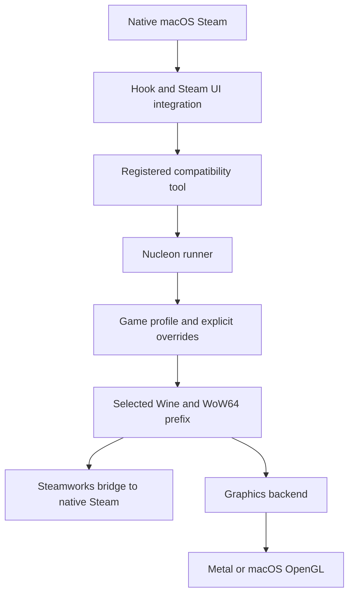

# Architecture

[README](README.md) · [Setup](SETUP.md) · [Troubleshooting](TROUBLESHOOTING.md)

## Launch flow

The injected hook enables compatibility features in macOS Steam. Local WebUI
patches expose controls. Steam invokes a registered tool script, which starts
the runner embedded in the CLI binary.

Steam integration uses an exact reviewed ARM64 contract under
`assets/steam-contracts/macos-arm64/`. Its typed TOML fields bind instructions to
a Mach-O UUID and executable-text SHA-256.

## Workspace

| Crate | Responsibility |
| --- | --- |
| `nucleon-cli` | Setup, runtime/backend management, launch, diagnostics, guard commands |
| `nucleon-core` | Detection, Steam integration, runner assembly, bridge staging, graphics configuration, validation |
| `nucleon-runner` | Per-game configuration, Wine arguments/environment, process supervision and shutdown |
| `nucleon-hook` | Frida Gum hooks inside Steam and Steam Helper; private client ABI integration |

There is no overlay-shim crate. Nucleon configures external graphics translation
implementations; it does not itself translate Direct3D.

## Runtime selection

The runner reads `<support_dir>/game_profiles/<AppID>.json` and explicit launch
overrides. Fields include `engine`, `wine`, `dxvk_path`, `vulkan_icd`,
`use_steam_shim`, `hud`, and `overlay`. The default support directory is
`~/Library/Application Support/nucleon`; `NUCLEON_SUPPORT_DIR` isolates an
experiment's profiles, bridge files, and logs.

Keep exact Wine/backend/driver recipes pinned. Import-table detection is a hint,
not proof that a backend supports a game. Dynamic loads and feature requirements
can differ. Automatic routing prefers GPTK for DX12 and DXMT for DX11, then uses installed
Vulkan translation layers. Candidates must contain readable PE DLLs for the game's
architecture. DXMT builtins must match the selected Wine; its Metal module and the
Vulkan ICD library must match the Wine host architecture. Vulkan manifests must
advertise at least API 1.3. GPTK requires complete x86_64 components and verified
D3DMetal exports from Wine. These file checks do not probe GPU features or guarantee
that a driver can initialize. Explicit engine/backend choices take precedence. A
per-game Wine selection keeps automatic routing on that runtime. Missing DX12
backends produce an actionable error rather than an OpenGL fallback. These
preferences do not predict performance or guarantee game compatibility.

Backend switches are serialized per prefix. Nucleon snapshots all managed DLLs,
publishes individual files atomically, and restores the previous contents and
symlinks if any staging or restoration step fails. Rollback failures retain the
backup and report its location.

The update guard compares every hook architecture's UUID and section contents,
ignoring code-signature blobs. It signs and verifies stale-hook replacements before
publishing them. Guard health requires valid signatures, injection, current hook,
WebUI patches, and the reviewed contract for the installed Steam client; cached
contracts alone do not mark a repair healthy.

GPTK assembly publishes complete generations with Wine/GPTK provenance stamps.
Launches resolve an immutable generation. Unix-call ABI pairing comes from the
selected Wine's own binaries, with signature-gated edits and verification;
assembly does not blindly replace matching opcodes.

## CPU and Windows architecture

Confirmed runtimes use x86_64 Wine under Rosetta. One win64 WoW64 prefix and
loader handle PE32 and PE64 games automatically. PE DLLs must still match the
game; Unix bridge libraries and drivers must match the host Wine process.
Nucleon does not currently supply a FEX execution path.

## Steamworks bridge

Native Steam must be running with the appropriate account session. Windows
client libraries and `lsteamclient` connect games to that client. The prefix's
`steam.exe` helper is used when the recipe needs it; direct execution is another
path. This mechanism is separate from the in-game overlay.

The Rust binder checks x86_64 bridge architecture and required ntdll exports,
rewrites the dependency to `@loader_path/ntdll.so`, and stages a symlink to the
selected Wine. Matching symbols are a prerequisite, not proof of future ABI
compatibility. The old ntdll adapter is no longer staged. DMC5's confirmed
recipe also needs its private Wine loader redirect patch; it is not a global
default for other games.

## Graphics paths

| Backend | Path | Qualification |
| --- | --- | --- |
| WineD3D | Direct3D → host OpenGL | GoNNER baseline; host OpenGL limits modern titles |
| DXVK | Direct3D → Vulkan → driver → Metal | Pinned DXVK-macOS/MoltenVK confirmed for DiRT and DMC5 |
| DXMT | Direct3D 11 → Metal | Configurable; outside these confirmed baselines |
| D3DMetal/GPTK | Direct3D 11/12 → Metal | Requires compatible Wine and Apple components; recheck after shim removal |
| VKD3D-Proton | Direct3D 12 → Vulkan → driver → Metal | Experimental; driver features and architecture are gates |
| D7VK | Legacy DirectDraw/Direct3D → Vulkan | Configurable; game-level validation required |

KosmicKrisp is a Vulkan driver, not Wine. ICD discovery does not establish host
architecture compatibility or backend feature support. The installed ARM-only
build was not a valid Rosetta path. Zink is a possible OpenGL-over-Vulkan route,
not a validated automatic replacement for host OpenGL in this project.

## Ownership and updates

Shutdown is scoped to the game's prefix/process tree, excluding other runners;
it must not kill all processes using a shared Wine directory. Prefix folder
redirection reduces host-folder access, but is not a macOS security sandbox or
a guarantee against privacy prompts. The update guard repairs local integration;
a repaired UI does not prove hook offsets are valid for a new client.

## Safety boundaries

The runner forbids unsafe Rust. Executable detection, client-contract validation,
and direct ntdll binding also forbid unsafe Rust. File parsing uses owned bytes
or safe cached reads. Slice-based byte matching is safe. Workspace lints deny
implicit unsafe operations inside unsafe functions.

Remaining unsafe operations and unresolved risks:

- Three CoreGraphics/Core Foundation boundaries in `validator.rs`. Ownership is
  retained/transferred explicitly and values are checked by runtime type.
- Foreign calls, raw image pointers, function-pointer conversion, and native
  code patches in the injected hook.
- Five mutable trampoline globals remain in spawn/filesystem hooks without
  established publication ordering. The compatibility detour uses typed
  `OnceLock` storage and a Frida transaction; code patches verify/roll back
  individually and are not jointly atomic.
- Exact-client instruction patch semantics and the eligibility callback's
  foreign ABI still require runtime validation. Removed C++ probing is not a
  proof that the remaining native boundaries are universally safe.
- Constructor `set_var` inside native Steam, which may already have threads
  reading the environment. Constructor timing is not a safety proof.
- Loader and kernel-copy FFI remain. Compatibility installation owns its pinned
  image and uses kernel copies instead of borrowing patched executable memory.
  The obsolete dyld enumerator and raw-memory scanner were removed.

Native detour installation is serialized across hook groups and runs once per group.
Original trampolines use release/acquire publication before the Gum transaction
activates any replacement. Failed preparation reverts the whole group and caches
the error; callbacks never transmute null pointers. Transaction cleanup also runs
on unwinding. Steam's `LSEnvironment` supplies `STEAM_EXTRA_COMPAT_TOOLS_PATHS`
before launch, preserving additional configured tool directories. The native
constructor never changes the process environment. Direct executable launches
must supply any additional tool paths in their own launch environment.
