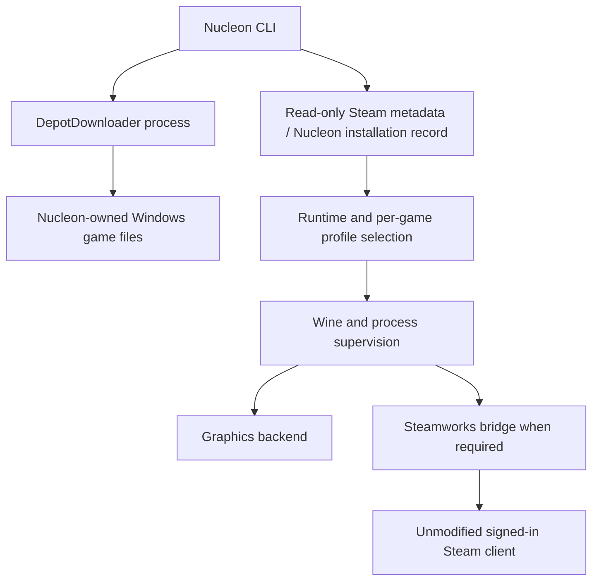

# Architecture

Nucleon owns installation records and launches. Desktop Steam remains an
unmodified service provider for games requiring Steamworks.

## Workspace

| Crate | Responsibility |
| --- | --- |
| `nucleon-cli` | Runtime/backend management, download orchestration, launch and diagnostics |
| `nucleon-core` | Metadata discovery, installation records, Wine/bridge and graphics configuration |
| `nucleon-runner` | Launch resolution, Wine execution, logging and process shutdown |
| `nucleon-devtools` | Explicit development probes |

## Download and launch ownership

The download provider runs as a child process with explicit Windows selection,
architecture, branch, language and destination arguments. Authentication stays
interactive; passwords are neither command arguments nor Nucleon settings. Only a
successful provider exit with Windows executable content publishes an installation
record. Failed updates retain the previous record. In-place provider updates can
leave partial files when interrupted; use update to resume and validate them.

`nucleon launch` and `nucleon steam play` resolve an explicit AppID, EXE, working
directory, arguments, per-game profile and prefix. They call the shared runner
directly.
Resolution previews do not create prefixes or start authentication or Wine.

Bounded appinfo framing reads cached launch metadata and rejects malformed or
unknown formats. `--exe` supplies an explicit executable when metadata is
unavailable. Ambiguous Windows launch entries require an explicit selection.
Game-relative metadata paths cannot escape the installation through traversal,
absolute paths or symlinks. Arguments follow Windows quoting rules and pass
directly to the process without shell evaluation.

Installation records, game files and prefix data belong to Nucleon. The runner
receives the AppID, paths, profile overrides and arguments explicitly from the CLI.

## Runtime selection

Schema-2 runtime descriptors advertise `steam_protocols` as capabilities. The
per-game profile selects a supported protocol and whether to use the Windows
helper; graphics backends do not select Steam launch policy. Schema-1 published
runtimes remain readable without rewriting their immutable generations. Prefix
family and ABI retain their saved-state meaning.

The runner reads `<support_dir>/game_profiles/<AppID>.json` and explicit launch
overrides. Fields include `engine`, `wine`, `dxvk_path`, `vulkan_icd`,
`use_steam_shim`, `hud`, and `overlay`. The default support directory is
`~/Library/Application Support/nucleon`; `NUCLEON_SUPPORT_DIR` isolates an
experiment's profiles, bridge files, and logs.

Keep exact Wine/backend/driver recipes pinned. Graphics detection reads ordinary
and delay-load PE import descriptors, including ordinal-only imports. Explicit
Direct3D libraries take precedence over shared DXGI; DXGI alone leaves the version
unknown. When no concrete graphics import is found, complete DLL names embedded
in the image can provide a labeled heuristic for packed games or dynamic loading.
The CLI and runner log identify the evidence source. Directory scans stay inside
the requested game and use a stable order. Detection remains a hint: dynamic loads
and feature requirements can differ. Automatic routing prefers GPTK for DX12 and DXMT for DX11, then uses installed
Vulkan translation layers. Candidates must contain readable PE DLLs for the game's
architecture. DXMT builtins must match the selected Wine; its Metal module and the
Vulkan ICD library must match the Wine host architecture. Vulkan manifests must
advertise at least API 1.3. GPTK requires complete x86_64 components and verified
D3DMetal exports from Wine. These file checks do not probe GPU features or guarantee
that a driver can initialize. Explicit engine/backend choices take precedence. A
per-game Wine selection keeps automatic routing on that runtime. Missing DX12
backends produce an actionable error rather than an OpenGL fallback. These
preferences do not predict performance or guarantee game compatibility.

Backend switches are serialized per prefix. Nucleon snapshots all managed DLLs,
publishes individual files atomically, and restores the previous contents and
symlinks if any staging or restoration step fails. Rollback failures retain the
backup and report its location.

## Steamworks bridge

Native Steam must be running with the appropriate account session. Windows
client libraries and `lsteamclient` connect games to that client. The prefix's
`steam.exe` helper is used when the recipe needs it; direct execution is another
path. This mechanism is separate from the in-game overlay.

Prefix staging keeps `i386-windows/lsteamclient.dll` and
`x86_64-windows/lsteamclient.dll` beneath the Steam bridge search root. Wine's
builtin lookup follows the original module name, so a flat x64 bridge can shadow
its 32-bit alias and fail relocation. The `x86_64-unix` lookup links to the same
prefix-private Unix libraries and ntdll binding used by the flat aliases.

Matching game-bundled D3DX and D3DCompiler DLLs receive native-first overrides.
This lets older effects use the shipped implementation when Wine's builtin
compiler lacks support, as observed with Braid's `d3dx9_43` and `d3dcompiler_43`.
The runner logs which bundled helpers it selects.

The Rust binder checks x86_64 bridge architecture and required ntdll exports,
rewrites the dependency to `@loader_path/ntdll.so`, and stages a symlink to the
selected Wine. Matching symbols are a prerequisite, not proof of future ABI
compatibility. A game can select a runtime advertising the Valve loader redirect when its
Steamworks protocol requires it.

## Remaining compatibility boundaries

The Steamworks bridge still depends on Steam's interfaces and the selected Wine
ABI. Compatibility with Steam updates, DRM, anti-cheat and third-party launchers
needs validation per game.

Independent startup must be validated for ownership and relaunch behavior per
game. Cloud synchronization, playtime, overlay, controller configuration and
Steam's Stop button are not established by a running process. Nucleon owns process
shutdown and per-prefix cancellation. Preserve known game recipes and distinguish
startup/device evidence from visual gameplay and input confirmation.
